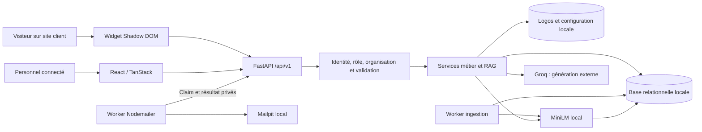
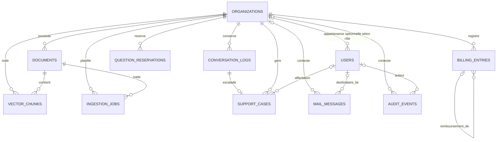
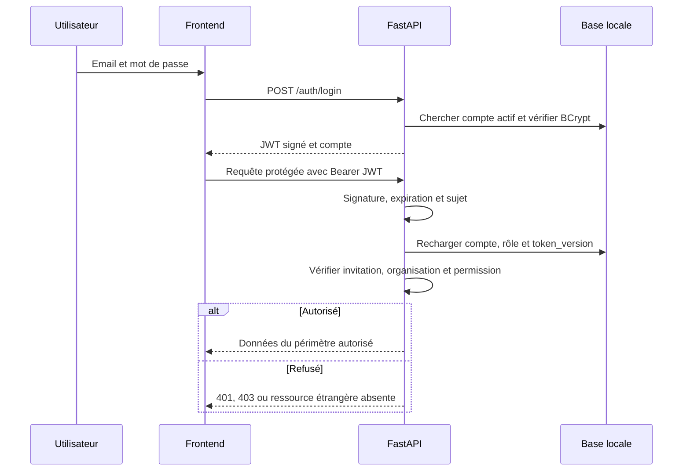
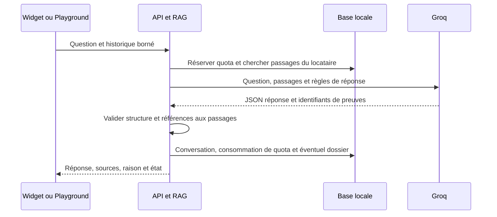
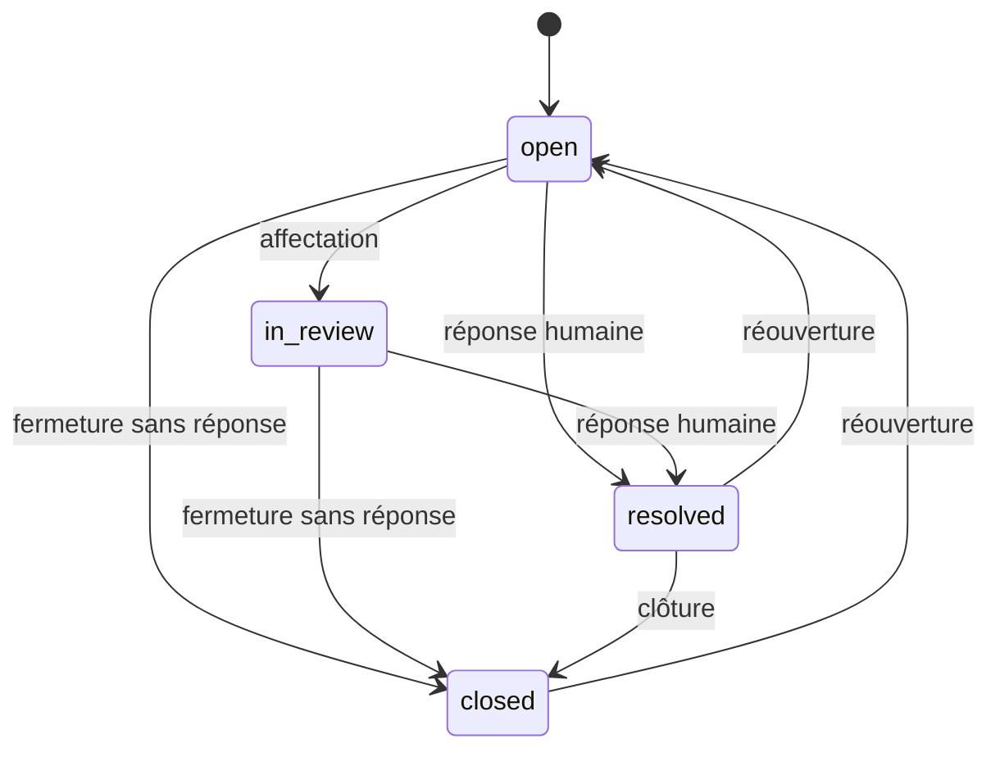

# SupportDeflect AI — README de suivi de la phase 1

**Réalisé par :**

- Dhia Ayed
- Ghaith Bouabda
- Amira Dhouib
- Syrine ben Ahmed

**Objet :** présenter au professeur l’application, ses choix de conception, son
fonctionnement réel et les preuves correspondant à la phase 1 du cahier des charges.
**Revue : 16 octobre 2026.**

[](https://github.com/dhiaxayed/SupportDeflect_AI/actions/workflows/ci.yml?query=branch%3Afeature%2Fsupportdeflect-v2)

Le badge et le lien montrent l’état réel du pipeline de la branche publiée.
Premier push vérifié le 16 octobre : commit `40b8b03` sur `feature/supportdeflect-v2`.
Les six jobs de son [pipeline complet](https://github.com/dhiaxayed/SupportDeflect_AI/actions/runs/38849007018)
ont réussi, avec PostgreSQL réel, navigateur et restauration Docker inclus.

**Document de référence :** `Local-Infrastructure-Project-Roadmap-EN-FR (1).docx`,
sections française et anglaise, « Phase 1 — Application · Semaines 1–4 ».
Les deux versions formulent les mêmes six tâches et la même condition de clôture.
Le document fourni reste la référence ; les exigences et décisions propres à
SupportDeflect ci-dessous précisent leur mise en œuvre.

L’analyse a couvert les 167 paragraphes du document, y compris ses tableaux et
ses deux langues. Empreinte SHA-256 de la source examinée :
`3f4a3b8e6a8e9990009e0b5c7e21bf350bee4d3a53caa3a8fc518e7fbfc706f6`.

## Sommaire

1. [Introduction et problématique](#1-introduction-et-problématique)
2. [Solution proposée et périmètre](#2-solution-proposée-et-périmètre)
3. [Lecture du cahier des charges](#3-lecture-du-cahier-des-charges)
4. [Exigences fonctionnelles et qualité](#4-exigences-fonctionnelles-et-qualité)
5. [Acteurs, rôles et fonctionnalités](#5-acteurs-rôles-et-fonctionnalités)
6. [Stack technique et justification](#6-stack-technique-et-justification)
7. [Architecture et responsabilités](#7-architecture-et-responsabilités)
8. [Schéma de base de données](#8-schéma-de-base-de-données)
9. [Authentification et autorisation](#9-authentification-et-autorisation)
10. [Parcours métier de bout en bout](#10-parcours-métier-de-bout-en-bout)
11. [API et contrats d’intégration](#11-api-et-contrats-dintégration)
12. [Installation et exécution locale](#12-installation-et-exécution-locale)
13. [Tests et preuves de fonctionnement](#13-tests-et-preuves-de-fonctionnement)
14. [Suivi des exigences et corrections](#14-suivi-des-exigences-et-corrections)
15. [Démonstration au professeur](#15-démonstration-au-professeur)
16. [Limites et passage aux phases suivantes](#16-limites-et-passage-aux-phases-suivantes)

## 1. Introduction et problématique

SupportDeflect AI est une application de support client destinée à plusieurs
organisations. Chaque organisation dispose d’un espace isolé : documents,
configuration du widget, équipe, conversations et demandes de suivi humain.
Une même plateforme héberge donc plusieurs clients sans fusionner leurs données.

Les équipes de support reçoivent des questions répétitives dont la réponse existe
dans une documentation dispersée. La recherche manuelle augmente le temps de
traitement. Une FAQ statique oblige le visiteur à trouver lui-même le bon article,
et une génération IA sans sources peut produire une réponse non justifiée.
Enfin, une question nécessitant un agent doit conserver son contexte au lieu de
disparaître à la fermeture d’un dialogue.

Le problème traité est ainsi double : rendre les connaissances de l’organisation
consultables dans une conversation et organiser une reprise humaine quand les
documents ne permettent pas une réponse appropriée. L’administration de la
plateforme doit également suivre les comptes, abonnements, communications et
indicateurs sans confondre ces activités avec celles des équipes clientes.

La valeur attendue est une meilleure disponibilité de l’information et une
réduction des demandes répétitives. Les indicateurs de l’application mesurent des
résultats observés ; ils ne démontrent pas automatiquement un gain financier ni
un nombre réel d’heures économisées.

## 2. Solution proposée et périmètre

La solution associe une base documentaire locale, une recherche hybride et une
génération de réponse encadrée par les passages trouvés. Cette organisation est
appelée RAG : recherche de connaissances avant génération. Le visiteur pose sa
question dans un widget intégré au site de l’organisation. Il reçoit une réponse
avec ses sources, une demande de précision ou une abstention explicite.

Lorsqu’un besoin de suivi métier est identifié, un dossier est créé dans Inbox.
L’agent peut l’examiner, l’affecter, conserver une note privée et publier une
réponse humaine. Le widget récupère cette réponse avec une autorisation limitée
au dossier. Une panne du fournisseur IA est signalée comme panne ; elle ne crée
pas artificiellement un dossier de connaissance manquante.

Le périmètre livré comprend :

- une vitrine, l’inscription, la connexion et le remplacement de mot de passe ;
- un espace administrateur locataire : connaissances, Playground, analytics,
  Studio widget, paramètres, équipe, abonnement et Inbox ;
- un espace agent dédié au traitement des dossiers ;
- une console plateforme pour les organisations, abonnements, indicateurs,
  encaissements/remboursements enregistrés, communications, audit et santé ;
- une API, une base persistante, un worker d’ingestion et un worker email ;
- des tests automatiques et des procédures de lancement/diagnostic.

Le registre financier enregistre des opérations réalisées ailleurs : aucun
prestataire de paiement ne débite ni ne rembourse une carte. Le widget n’accède
pas aux commandes ou aux comptes du site client. Les PDF scannés sans texte ne
font pas l’objet d’un OCR caché. La reprise humaine est asynchrone ; l’application
ne promet pas une présence instantanée des agents.

## 3. Lecture du cahier des charges

La phase 1 demande de passer des besoins à une application réelle et fonctionnelle.
Sa définition du « fait » associe trois conditions : exécution locale, cas
d’usage principaux couverts de bout en bout et suite de tests réussie.
Un diagramme ou une compilation réussie ne suffit donc pas à lui seul.

| Exigence explicite de phase 1 | Livrable attendu dans SupportDeflect |
|---|---|
| Cahier des charges et architecture | Acteurs, besoins, règles métier, composants, flux et décisions expliqués dans ce suivi et les guides liés. |
| Frontend | Pages réelles connectées aux données/API, navigation selon le rôle et gestion des états asynchrones. |
| Backend / API | Contrats HTTP validés, authentification, autorisations et services métier exécutables. |
| Schéma de base de données | Entités, relations, contraintes, migrations et persistance réelle. |
| Authentification | Comptes, mots de passe hachés, sessions signées, contrôle des rôles et révocation. |
| Suite de tests | Vérifications API, composants, métier, sécurité et parcours navigateur qui doivent réussir. |
| Condition de clôture | Une application locale fonctionnelle qui relie effectivement tous ces éléments. |

Le cahier place la VM Linux, Docker Compose, les volumes et le reverse proxy en
phase 2. Il place le workflow Git, le pipeline à chaque push et le runbook en
phase 3. Leur configuration existe déjà dans le dépôt, mais leur présence ne
vaut pas preuve de déploiement réel. La décision de provisionnement est une
installation manuelle d’Ubuntu Server ; le reverse proxy cible est Traefik et le
déploiement reste manuel.

**Point de conformité transversal :** le cahier annonce une infrastructure sans
dépendance cloud. L’implémentation actuelle utilise Groq pour la génération, avec
base, fichiers, embeddings et SMTP locaux. Cette exception est déjà consignée
dans le projet ; elle doit être présentée explicitement au professeur. La phase
applicative est vérifiable localement, mais une conformité stricte « zéro cloud »
de l’ensemble du projet demanderait de remplacer ce fournisseur par un moteur
local et d’en vérifier les performances. Aucun tel remplacement n’est revendiqué ici.

## 4. Exigences fonctionnelles et qualité

### 4.1 Besoins fonctionnels

| Identifiant | Besoin et résultat attendu |
|---|---|
| F01 | Créer une organisation avec son administrateur et connecter un compte actif. |
| F02 | Importer PDF/TXT/Markdown ou URL publique et suivre l’indexation jusqu’à un état explicite. |
| F03 | Rechercher uniquement dans les connaissances de l’organisation concernée. |
| F04 | Tester/poser une question avec sources, clarification ou absence de connaissance identifiables. |
| F05 | Sauvegarder le design du widget et retrouver ce même rendu sur un site client indépendant. |
| F06 | Créer puis traiter un dossier humain avec note interne privée et réponse accessible au seul visiteur autorisé. |
| F07 | Inviter, activer/désactiver et gérer les membres autorisés de l’équipe. |
| F08 | Afficher l’usage et appliquer les quotas même lorsque plusieurs requêtes arrivent simultanément. |
| F09 | Administrer les organisations, périodes et événements commerciaux avec trace d’audit. |
| F10 | Préparer des communications revues, suivre leur état et capturer les invitations dans le SMTP local. |

### 4.2 Exigences de qualité appliquées

L’autorisation est contrôlée par le backend, même si l’interface masque une action.
L’organisation provient du compte authentifié et non d’un identifiant choisi par
le navigateur. Les ressources étrangères sont exclues des requêtes et tests.

Les écritures métier associées à un audit ou à un mail utilisent des transactions
cohérentes. Les contraintes SQL restent la dernière barrière contre les doublons.
Les réservations de quotas incluent les requêtes en cours ; un traitement long
ne garde pas un verrou de quota pendant l’appel au fournisseur IA.

Les erreurs sont distinguées : validation, droits, quota, fichier invalide,
indexation échouée et fournisseur indisponible. L’interface garde les brouillons
pendant les mises à jour asynchrones et propose une récupération adaptée. Une
réponse provenant d’une ancienne session ne peut pas remplir le cache d’un autre compte.

Les secrets se configurent hors du code. Les messages/journaux publics ne doivent
pas contenir les mots de passe, jetons, corps de documents privés ou invitations.
Les dates de décision sont traitées en UTC. Le code est accompagné de docstrings,
commentaires de contrat et d’un [inventaire français par fichier](docs/FILE_GUIDE_FR.md).

## 5. Acteurs, rôles et fonctionnalités

Les rôles applicatifs décrivent des permissions. Ils sont distincts des quatre
auteurs du projet et des accès techniques à la machine hôte.

| Acteur | Accès | Fonctions principales | Frontière de permission |
|---|---|---|---|
| Visiteur | Widget du site client | Question, sources, clarification, suivi d’une réponse humaine. | Pas de session personnel, de liste de documents ou de notes internes. |
| Administrateur locataire (`tenant_admin`) | `/dashboard` | Connaissances, Playground, analytics, design, intégration, équipe, Inbox et usage. | Son organisation uniquement ; conditions commerciales modifiées par la plateforme. |
| Agent de support (`support_agent`) | `/dashboard/inbox` | Lire, affecter, annoter, examiner, résoudre, fermer/réouvrir un dossier. | Aucun accès administratif aux documents, au design ou à la plateforme. |
| Super-administrateur (`super_admin`) | `/platform` | Organisations, abonnements/périodes, BI, registre manuel, communications, audit, santé et reprises. | Aucune appartenance implicite à chaque locataire ni accès automatique aux corps documentaires. |
| Opérateur technique | CLI et système hôte | Configuration, migrations, bootstrap, supervision, sauvegarde/restauration et mise à jour. | Accès système de confiance ; ce n’est pas un rôle de la page de connexion. |

L’administrateur locataire attend que le document soit indexé avant de tester les
réponses. Il configure les domaines clients autorisés et sauvegarde son design
avant de copier le snippet. Le Studio et le site client emploient le même moteur
JavaScript, ce qui évite une prévisualisation différente de l’intégration réelle.

L’agent distingue la réponse IA originale et sa propre réponse. Une note interne
reste privée ; seul le statut et la réponse humaine publique sont exposés au
visiteur autorisé. Le passage à `resolved` exige une réponse humaine non vide.

Le super-administrateur peut archiver puis restaurer une organisation sans
effacer son historique financier/audit. Il enregistre les montants dans une
devise précise et en unités mineures entières. Les campagnes nécessitent une
audience revue avant mise en file ; un état « envoyé » représente l’acceptation SMTP.

Deux acteurs techniques complètent ces rôles : le worker d’ingestion transforme
les sources en passages indexés, et Nodemailer livre les messages persistés.
Le jeton du worker mail est distinct du JWT d’un utilisateur.

## 6. Stack technique et justification

Les versions de référence sont fixées par les manifestes et lockfiles du dépôt ;
le tableau indique les familles utilisées, sans imposer une version plus récente.

| Couche | Technologies | Utilité dans le projet |
|---|---|---|
| Interface | React 19, TypeScript, TanStack Start/Router | Composants, routes par fichiers, rendu serveur et navigation client. |
| État serveur UI | TanStack React Query | Cache de requêtes, invalidations et polling ciblé des travaux asynchrones. |
| Présentation | Tailwind CSS 4, Radix UI, Recharts, Lucide | Thème, primitives accessibles, graphiques et icônes. |
| Build/tests UI | Vite 8, ESLint, TypeScript, Vitest/Testing Library, Playwright | Build client/SSR, règles statiques, composants et parcours navigateur réels. |
| API | Python 3.11+, FastAPI, Uvicorn, Pydantic | Routage HTTP, validation typée, schéma OpenAPI et serveur ASGI. |
| Persistance | SQLAlchemy 2, Alembic | Modèles, sessions, transactions et migrations versionnées. |
| Base native | SQLite avec vecteurs JSON persistés | Développement local sans serveur SQL supplémentaire. |
| Base cible hébergée | PostgreSQL et pgvector | Base relationnelle partagée et recherche vectorielle native/index HNSW. |
| Recherche IA | Sentence Transformers, MiniLM multilingue 384, BM25Plus | Embeddings locaux, recherche sémantique/lexicale et fusion des classements. |
| Génération | SDK Groq, modèle fourni par configuration | Réponse structurée à partir des passages ; nécessite Internet et une clé réelle. |
| Identité | BCrypt, PyJWT, cryptographie | Hachage des mots de passe, sessions signées et chiffrement des secrets d’invitation en attente. |
| Emails | Node 24, Nodemailer, Mailpit local | Worker SMTP séparé, contenu HTML/texte et boîte de capture de démonstration. |
| Infrastructure préparée | Docker, Compose, Traefik | Images, orchestration, réseau/volumes et entrée unique de la future phase 2. |
| Automatisation | pytest, Ruff, GitHub Actions | Tests métier/API, analyse Python et pipeline build/test sans déploiement automatique. |

SQLite est un choix de développement ; il ne démontre pas le comportement de
verrouillage de PostgreSQL. De même, les doubles IA des tests permettent une
recette déterministe, tandis qu’une vérification distincte exerce MiniLM et Groq réels.

## 7. Architecture et responsabilités

### 7.1 Vue des échanges



Le frontend présente les données et collecte les actions. Il n’est propriétaire
ni des permissions ni des quotas. Les routers FastAPI traduisent HTTP en appels
métier après validation et résolution du compte. Les services portent les
invariants, orchestrent les traitements et définissent leurs transactions.
SQLAlchemy et Alembic gèrent respectivement la persistance et le schéma.

L’ingestion est durable : la tâche est enregistrée en base avec le document.
Un arrêt du processus ne transforme pas une demande acceptée en travail perdu
en mémoire. Les baux et contrôles de publication empêchent un ancien worker de
valider le résultat d’une tentative remplacée.

### 7.2 Organisation du dépôt

```text
SupportDeflect_AI/
  frontend/                 UI, contrats HTTP, composants, tests unitaires/E2E
  backend/
    app/                    API, schémas, identité, modèles et services
    alembic/                Révisions 0001 à 0007
    scripts/                Bootstrap, worker et outils de vérification
    tests/                  Tests unitaires, métier, API et concurrence
    integration/            Test PostgreSQL/pgvector réel conditionnel
  mailer/                   Worker SMTP, modèles et tests
  widget/                   Exemple de site client et logo mail
  scripts/                  Lanceur natif, configuration, contrôles, backup/restore
  infra/                    Routage Traefik et option TLS
  docs/                     Guides, preuves, architecture et procédures
  .github/workflows/ci.yml   Build et tests à chaque push/PR
```

Les responsabilités précises de chaque fichier figurent dans
[FILE_GUIDE_FR](docs/FILE_GUIDE_FR.md). Les contrats HTTP complets figurent dans
[API](docs/API.md) et les décisions techniques dans [ARCHITECTURE](docs/ARCHITECTURE.md).

## 8. Schéma de base de données

### 8.1 Entités et invariants

Le modèle actuel comporte 14 tables applicatives, auxquelles Alembic ajoute sa
table technique de version. Les identifiants et relations sont déclarés dans
[models.py](backend/app/models.py).

| Table | Rôle | Invariant principal |
|---|---|---|
| `organizations` | Racine locataire, identité widget, design et contrat. | Identifiant public unique ; archivage réversible. |
| `users` | Email, hash, rôle, compte actif, version et expiration d’invitation. | Email globalement unique ; super_admin sans organisation, rôles locataires avec organisation. |
| `documents` | Source, métadonnées et état d’indexation. | Source rattachée à son organisation ; document désactivé exclu des recherches. |
| `vector_chunks` | Passages, vecteurs et identité de modèle. | Unicité organisation/document/index du passage ; modèle compatible requis. |
| `ingestion_jobs` | Travail durable, tentative et bail. | Publication acceptée seulement pour le bail encore courant. |
| `conversation_logs` | Question, réponse IA, sources et mesures originales. | Résultat IA conservé indépendamment de la réponse humaine. |
| `support_cases` | Suivi humain, agent, note et réponse. | Un dossier par conversation ; statuts SQL bornés. |
| `question_reservations` | Capacité de quota en cours de traitement. | Date d’expiration et périmètre locataire. |
| `rate_limit_events` | Événements de limitation partagés. | Comptage par clé et fenêtre de temps. |
| `audit_events` | Auteur, action, cible, périmètre et métadonnées. | Données de suivi bornées et sans secrets. |
| `billing_entries` | Registre des paiements/remboursements saisis. | Montant positif, type autorisé, clé d’idempotence unique et lien de remboursement. |
| `mail_messages` | Outbox, modèle, destinataire, état et bail. | Secret d’invitation chiffré ; clé de déduplication et accusé liés au claim. |
| `mail_automations` | Activation des événements mail connus. | Une préférence par événement ; absence de ligne traitée selon les règles du service. |
| `mail_worker_state` | Heartbeat et disponibilité SMTP observée. | État du transport distinct de la réception dans une boîte externe. |

### 8.2 Diagramme relationnel principal



Ce diagramme synthétise les clés étrangères principales ; il ne remplace pas la
liste des colonnes/contraintes du modèle. `mail_automations`, `mail_worker_state`
et `rate_limit_events` sont des tables techniques indépendantes de ces relations.
Le nom d’organisation affiché dans un email n’est pas une clé d’autorisation.

### 8.3 Migrations et persistance

Les migrations évoluent de `0001_baseline` à `0007_question_reservations` : schéma
initial ; rôles/support/audit ; pgvector ; administration/registre/mail ; design ;
identité des embeddings ; réservations de questions. Une base existante est
mise à jour par `alembic upgrade head`, sans effacer ses données pour contourner
une différence de schéma.

Les sessions SQL sont fermées en fin de contexte/requête. Les erreurs
d’intégrité concurrentes imposent un rollback avant réutilisation. Pour un
paiement/remboursement idempotent, la clé existante permet de retrouver le
résultat validé ; une répétition conflictuelle n’ajoute pas un second événement.

En développement, SQLite conserve réellement documents, passages et vecteurs.
Une vérification distincte ferme/réouvre les connexions et contrôle la recherche
ainsi que l’exclusion d’un autre locataire. PostgreSQL fournit le stockage
vectoriel natif cible ; son test d’intégration reste distinct et exige un serveur réel.

## 9. Authentification et autorisation

### 9.1 Identité et cycle de session



Le mot de passe est haché avec BCrypt et jamais renvoyé dans les schémas de
compte. La limite de 72 octets UTF-8 est contrôlée avant BCrypt pour éviter une
troncature silencieuse. Le JWT contient une expiration et une version de session.
La signature seule ne décide pas des droits : le compte courant est relu en base.

Un changement de mot de passe, de rôle ou d’état incrémente la version afin de
révoquer les anciens jetons. Un compte inactif ou une organisation archivée
ne peut pas conserver l’accès par une session ancienne. Le frontend nettoie son
cache sur changement de compte et rejette les réponses asynchrones d’une session obsolète.

### 9.2 Inscription et invitation

L’inscription publique crée une organisation avec un administrateur locataire et
un essai de quatorze jours ; elle ne permet pas de demander le rôle super_admin.
Le super-administrateur est créé par une commande opérateur avec saisie privée.

Une invitation emploie un mot de passe temporaire expirant après sept jours.
La première session permet uniquement de lire son compte et de remplacer le
mot de passe. Après remplacement, les anciennes sessions sont révoquées et une
nouvelle connexion est nécessaire. Un renouvellement fait évoluer les identifiants
et invalide les invitations précédentes selon leur génération.

### 9.3 Widget et isolation

Le `company_id` public identifie la configuration, mais n’authentifie pas un agent.
La liste des origines autorisées est vérifiée ; une liste vide refuse l’intégration.
Ce filtre protège le contexte navigateur et ne constitue pas une protection
absolue contre un client HTTP capable de fabriquer un en-tête Origin.

Le suivi visiteur utilise un jeton signé d’audience `widget-case`, lié à
l’organisation et au dossier pendant sept jours. Il autorise seulement le statut
et la réponse finale. Il est transmis dans le corps POST, sans exposer les notes
privées ou le JWT administrateur dans l’URL ou le snippet.

## 10. Parcours métier de bout en bout

### 10.1 Importer et indexer une connaissance

```mermaid
flowchart LR
  Source[Fichier ou URL] --> Validation[Type, taille, URL publique et quota]
  Validation --> Transaction[Document et tâche persistés]
  Transaction --> Claim[Claim atomique du worker]
  Claim --> Extraction[Extraction et découpage local]
  Extraction --> Vecteurs[MiniLM : vecteurs 384]
  Vecteurs --> Publication[Contrôle du bail et commit des passages]
  Publication --> Recherche[Document actif et indexé interrogeable]
```



La route retourne d’abord un état d’admission. L’interface suit ensuite `pending`,
`processing`, `indexed` ou `failed`. La validation URL refuse les destinations
internes et recontrôle les redirections ; cela limite les attaques SSRF.
Un document supprimé pendant l’inférence ne peut pas être republié par le
résultat tardif d’un worker. Les tâches abandonnées sont reprises selon leur bail
et leur budget de tentatives.

### 10.2 Répondre avec des preuves

La question est validée puis admise par une réservation de quota. Les passages
actifs de l’organisation sont classés par recherche dense et lexicale. Les en-têtes
et passages voisins ajoutent le contexte utile, dans un budget explicite. L’historique
borné aide à comprendre une référence mais ne devient pas une source documentaire.



Le serveur vérifie que les identifiants cités correspondent à de vrais passages
fournis. Cela empêche de publier une référence inventée ; cela ne prouve pas
formellement que toute formulation du modèle découle de la source. Le score de
recherche est une similarité, pas un pourcentage de vérité.

| Situation | Résultat attendu |
|---|---|
| Salutation seule | Réponse conversationnelle, sans source ni dossier humain. |
| Fait documenté | Réponse avec passages vérifiés. |
| Sujet ambigu | Demande de précision, sans dossier artificiel. |
| Fait absent ou suivi métier requis | Abstention/suivi humain ; dossier pour un visiteur widget. |
| Panne Groq ou recherche | Erreur opérationnelle explicite, sans fausse réponse ni faux dossier métier. |

### 10.3 Reprendre une demande humainement



L’agent consulte la question, la réponse IA et les sources disponibles. Il peut
affecter le dossier à un membre actif du même locataire. La note interne et la
réponse publique sont enregistrées par deux actions différentes. Le widget
vérifie les dossiers en attente toutes les quinze secondes quand panneau et
document sont visibles. Le stockage navigateur conserve l’accès aux suivis ;
son effacement fait perdre cet accès local. La réponse humaine ne réécrit pas
le résultat IA original dans les métriques.

### 10.4 Inviter un agent et livrer le mail

La création du membre, les identifiants temporaires, l’audit et l’outbox sont
cohérents dans la transaction. Le worker mail revendique ensuite une livraison,
décrypte uniquement les informations nécessaires, prépare texte/HTML échappé
et remet le message au SMTP local. Le résultat est accusé avec le token de claim.

Une tentative réseau d’accusé ne relance pas SMTP dans ce cycle. Une coupure après
acceptation SMTP peut laisser un état incertain ; cet état est soumis à examen
plutôt qu’à une promesse d’envoi « exactement une fois ». Les identifiants sensibles
de l’outbox sont supprimés après les chemins de livraison/annulation/expiration prévus.

## 11. API et contrats d’intégration

L’API métier utilise le préfixe `/api/v1`. Les entrées/sorties sont des JSON, sauf
les fichiers multipart et exports explicitement documentés. La connexion prend
un JSON email/password. Les requêtes protégées utilisent `Authorization: Bearer`.

| Famille | Exemples | Accès |
|---|---|---|
| Identité | `/auth/register`, `/auth/login`, `/auth/me`, `/auth/change-password` | Public ou compte actif selon l’action. |
| Connaissances | `/documents`, `/documents/upload`, `/documents/url` | Administrateur locataire. |
| Chat et paramètres | `/chat`, `/settings/widget`, `/settings/subscription` | Administrateur locataire. |
| Équipe et Inbox | `/team/users`, `/support-cases` | Permissions locataire/agent propres à chaque action. |
| Widget | `/widget/script.js`, `/widget/settings/{company_id}`, `/widget/{company_id}/chat` | Public avec politique d’origine et quotas. |
| Plateforme | `/platform/...` et familles billing/mail documentées | Super-administrateur. |
| Worker mail | `/internal/mail/...` | Jeton de service privé. |
| Santé | `/healthz`, `/healthz/db` | Liveness distincte de disponibilité du schéma. |

Le backend distingue notamment `401` session invalide, `403` permission/origine
refusée, `404` ressource absente ou étrangère, `402` quota/abonnement, `409` conflit,
`413` fichier trop volumineux, `422` schéma invalide et `429` limitation de débit.
Le client accepte les erreurs sous forme de texte structuré ou de liste de
validation ; il ne suppose pas que toute réponse réussie correspond encore à la session active.

Les formats complets, routes exactes et exemples se trouvent dans [API.md](docs/API.md).
La documentation interactive `/docs` et OpenAPI sont activés uniquement si
`DOCS_ENABLED=true` ; ce n’est pas une route obligatoirement publique en production.

## 12. Installation et exécution locale

### 12.1 Préparer une installation native

Prérequis : Git, Python 3.11 ou compatible avec les dépendances verrouillées,
Node 24, npm et le binaire Mailpit. La génération réelle demande une clé Groq et
un modèle accessible à ce compte. Le premier chargement MiniLM télécharge ses poids ;
les lancements suivants peuvent employer le cache local.

Depuis PowerShell, à la racine d’un clone neuf :

```powershell
git clone --branch feature/supportdeflect-v2 https://github.com/dhiaxayed/SupportDeflect_AI.git
cd SupportDeflect_AI
python -m venv .venv
.venv/Scripts/python.exe -m pip install --index-url https://download.pytorch.org/whl/cpu torch==2.14.0+cpu
.venv/Scripts/python.exe -m pip install -r backend/requirements-dev.txt
npm ci --prefix frontend
npm ci --prefix mailer
Copy-Item backend/.env.example backend/.env
```

Éditer ensuite le nouveau `backend/.env` en privé : remplacer `SECRET_KEY` et
`MAILER_SERVICE_TOKEN` par des secrets aléatoires indépendants d’au moins 32 caractères,
définir `GROQ_API_KEY`/`GROQ_MODEL` et conserver le profil SQLite natif cohérent.
Le worker démarré par le lanceur reçoit le même token mail. Ne pas recopier une
clé dans un fichier `VITE_*`, une capture ou le dépôt. Sur une installation déjà
configurée, conserver le fichier existant au lieu de le remplacer par le modèle.

Après avoir installé Mailpit depuis sa distribution et repéré son exécutable :

```powershell
.venv/Scripts/python.exe scripts/run_native.py --check --mailpit CHEMIN_MAILPIT
.venv/Scripts/python.exe scripts/run_native.py --mailpit CHEMIN_MAILPIT --open-browser
```

`CHEMIN_MAILPIT` doit être remplacé par le chemin local, entre guillemets s’il
contient des espaces. `--node CHEMIN_NODE` permet de choisir explicitement Node 24.
Le lanceur applique les migrations, réindexe si nécessaire, prépare les modèles
et supervise API, ingestion, frontend, mailer et Mailpit. Laisser le terminal
ouvert ; Ctrl+C arrête ses processus. Le double-clic sur
`demarrer-supportdeflect.bat` est le raccourci prévu sur un checkout déjà configuré.

| Point local natif | Usage |
|---|---|
| `http://127.0.0.1:5173` | Interface. |
| `http://127.0.0.1:8000/healthz/db` | Connectivité et révision courante de la base. |
| `http://127.0.0.1:8025` | Boîte Mailpit locale du développeur. |
| `127.0.0.1:1025` | SMTP de capture, pas une URL de page. |

Créer le compte plateforme dans un second terminal si nécessaire :

```powershell
cd backend
../.venv/Scripts/python.exe scripts/create_super_admin.py
```

La commande demande les identifiants en privé et refuse les promotions/réinitialisations
silencieuses de comptes existants. Les comptes de test ne sont pas des comptes de démonstration
à conserver en production.

### 12.2 Équivalent manuel et futur hébergement

Les commandes de lancement séparées, chemins de cache et reindexation sont dans
le [README principal](README.md#native-development). Le chemin Docker préparé
utilise `scripts/configure.py`, un `.env` racine privé, puis `docker compose up -d --build`.
La procédure [VM_SETUP](docs/VM_SETUP.md) concerne la phase 2 ; la réussite native
ne remplace pas sa recette reverse proxy/volumes/redémarrage sur Linux.

## 13. Tests et preuves de fonctionnement

### 13.1 Stratégie de validation

Les tests backend vérifient contrats HTTP, rôles, locataires, transactions,
quotas, invitations, grounding et concurrence. Les tests composants contrôlent
transport/session, formulaires et courses d’état. Playwright démarre une API et
une base jetables, ouvre les vraies pages et exécute les parcours multi-rôles.
Le site client de test possède volontairement un CSS hostile pour éprouver
l’isolation du widget.

Les doubles IA sont explicites et limités à `ENVIRONMENT=test`. Ils rendent les
assertions reproductibles sans confondre recette UI et disponibilité d’un
fournisseur. Le script réel MiniLM/Groq migre sa base temporaire, indexe une
politique synthétique, réouvre la connexion et interroge le widget réel.

| Vérification | Dernière preuve disponible dans cette revue |
|---|---|
| Backend complet | 165 tests réussis après documentation ; 1 avertissement upstream Starlette, sans échec. |
| Frontend composants/unitaires | 44 tests réussis dans 8 fichiers ; pool threads, un worker sur cet hôte Windows. |
| Parcours navigateur | 12 parcours réussis localement en 2,6 minutes et sur GitHub/Linux en 2,3 minutes, dont SMTP Mailpit réel et site client indépendant. |
| Mailer | 8 tests MIME/transport/redirect réussis. |
| Scripts opérateur | 12 tests de sécurité configuration/archive/probes réussis. |
| Qualité statique/build | Ruff backend/scripts, ESLint, TypeScript, build client/SSR et smoke production contrôlés séparément. |
| Documentation | 634 déclarations Python et 405 contrats JS/TS commentés ; guide couvrant les fichiers maintenus et contrôle automatique. |
| MiniLM/Groq réels | Vecteurs 384, un passage persisté/relu et exclusion inter-locataire ; salutation et réponse widget sourcée HTTP 200 avec Groq réel. |
| PostgreSQL/pgvector réel | 1 skip local faute de serveur ; **1 test réussi sur PostgreSQL réel dans GitHub Actions**, migrations, HNSW, isolation et claims concurrents vérifiés. |

Le registre [TESTING.md](docs/TESTING.md) donne les dates, commandes, résultats
exacts et limites. Les anciens passages restent datés ; un ancien résultat n’est
pas rebaptisé en nouvelle exécution. Le [rapport de documentation](docs/DOCUMENTATION_REVIEW_2026-10-16.md)
explique les comparaisons syntaxiques effectuées avant/après les commentaires.

### 13.2 Commandes de reproduction

Depuis `backend`, avec le venv du projet :

```powershell
../.venv/Scripts/python.exe -m ruff check .
../.venv/Scripts/python.exe -m pytest -q
../.venv/Scripts/python.exe -m pytest integration -q -rs
../.venv/Scripts/python.exe scripts/verify_local_knowledge.py --groq
```

Le dernier script effectue de vraies requêtes Groq avec la configuration privée
et uniquement une politique synthétique. Omettre `--groq` pour vérifier la
recherche locale sans génération. Le test PostgreSQL exige une base isolée dont
le nom répond au garde-fou du test ; ne jamais pointer une base utilisateur pour le faire passer.

Depuis `frontend`, Node 24 disponible dans PATH :

```powershell
npm run lint
npm run typecheck
npm run test:run -- --pool=threads --maxWorkers=1
npm run build
node scripts/check-production.mjs
# Définir MAILPIT_BINARY vers le binaire installé pour inclure la recette SMTP.
npx playwright install chromium
npx playwright test
```

Depuis la racine :

```powershell
.venv/Scripts/python.exe scripts/check_documentation.py
.venv/Scripts/python.exe -m ruff check scripts --config backend/pyproject.toml
.venv/Scripts/python.exe -m unittest discover -s scripts/tests -v
node --test mailer/templates.test.mjs
```

Un résultat « skip » ou une erreur de démarrage de worker n’est pas une réussite.
Sur cet hôte, le premier pool forks Vitest a échoué avant de lancer un fichier ;
le passage complet threads a ensuite exécuté les 44 tests sans modifier les assertions.

## 14. Suivi des exigences et corrections

### 14.1 Matrice de phase 1

| Exigence du cahier | Éléments vérifiables | Critère de recette |
|---|---|---|
| Cahier des charges / architecture | Ce README ; ARCHITECTURE ; API ; modèles et guides fonctionnels. | Acteurs, périmètre, flux, responsabilités et limites expliqués. |
| Frontend | `frontend/src/routes`, composants/hooks et client API partagé. | Vraies pages liées au backend ; lint/types/build, tests composants et navigateurs. |
| Backend / API | `backend/app/routers`, services, schémas et dépendances. | Entrées invalides refusées, règles métier et erreurs exercées par la suite API. |
| Schéma de données | 14 tables ; Alembic 0001–0007 ; SQLite persistante. | Migrations et contraintes testées ; réouverture/recherche persistée vérifiée. |
| Authentification | BCrypt, JWT, compte relu, rôles, version, invitation et révocation. | Refus mauvais rôle/locataire/session, changement obligatoire et tests de course. |
| Suite de tests | Backend, frontend, mailer, opérateur et E2E. | Tous les groupes applicatifs exécutés réussissent ; intégration non disponible signalée. |
| Exécution locale et parcours E2E | API/UI/base de test réellement démarrées, site client indépendant et SMTP local. | Inscription→connaissance→réponse→dossier→réponse humaine ; administration/invitation exercées. |

Le statut de clôture applicative repose sur les résultats datés du registre,
les comportements observés et la révision publiée. Il n’étend pas la validation
locale aux étapes VM ou « zéro cloud » décrites dans les limites.

### 14.2 Corrections intégrées et revue courante

L’audit technique précédent a ajouté/corrigé les protections suivantes : claims
d’ingestion atomiques et baux clôturés, quotas/questions et remboursements
concurrents, conflits d’unicité email, rejouabilité d’événements financiers,
rejet des retours de session obsolètes, conservation des brouillons/choix de
fichiers, saisie IME du widget et confidentialité des handlers de journaux.
Il a également corrigé la validation gzip avant restauration et le refus des
redirections sur l’API privilégiée du worker mail.

La passe de commentaires a ensuite documenté modules, classes, fonctions,
composants, hooks, tests et configurations. Une comparaison des arbres de
syntaxe distingue ces ajouts d’une modification de logique. Les JSON stricts,
images et fichiers générés sont expliqués dans un inventaire associé sans casser
leur format. Le contrôleur de documentation est désormais branché sur le pipeline.

La présente revue corrige aussi les formulations historiques devenues fausses :
un fournisseur indisponible ne déclenche pas un faux dossier, l’historique borné
peut accompagner la question vers Groq, et la révision de schéma comprend bien
`0007`. Les procédures de restauration précisent leurs permissions enregistrées
et les preuves d’intégration non exécutées restent identifiées.

## 15. Démonstration au professeur

Préparer une organisation et des données synthétiques. Une politique simple
peut indiquer : « La livraison prend trois jours ouvrés ; les retours sont
acceptés pendant trente jours. » Ne pas présenter un dossier privé ou des
secrets de configuration sur l’écran de démonstration.

1. **Présenter le besoin et l’architecture.** Expliquer les acteurs et suivre un
   échange navigateur→API→base avec le diagramme de la section 7.
2. **Inscrire une organisation.** Montrer le rôle administrateur locataire et
   l’absence d’accès plateforme ; se déconnecter puis se reconnecter.
3. **Importer la politique.** Montrer l’état en attente puis indexé et le nombre
   de passages. Expliquer pourquoi « upload accepté » diffère de « indexé ».
4. **Tester le Playground.** Poser une question documentée, ouvrir la source,
   puis une question absente ; distinguer clarification et panne fournisseur.
5. **Configurer le widget.** Changer identité/couleur, déclarer le domaine,
   sauvegarder puis recharger pour vérifier la persistance.
6. **Intégrer le snippet sur un autre site local.** Montrer le même design et
   poser une question dans le vrai widget, pas uniquement dans la prévisualisation.
7. **Traiter une demande humaine.** Poser une question nécessitant un agent,
   ouvrir Inbox, écrire une note privée et une réponse publique ; constater le
   suivi dans le widget sans divulgation de la note.
8. **Inviter un agent.** Voir la capture Mailpit locale, la première connexion
   et le remplacement obligatoire du mot de passe avant l’accès Inbox.
9. **Présenter la plateforme.** Expliquer organisation, abonnement, indicateurs,
   registre manuel et audit sans assimiler les données synthétiques à de vraies recettes.
10. **Montrer les tests.** Présenter les résultats datés et un refus d’accès
    représentatif ; expliquer les tests factices contrôlés et le contrôle IA réel distinct.

Terminer en reliant chaque étape à la matrice de phase 1, puis présenter les
conditions encore nécessaires pour valider les phases suivantes.

## 16. Limites et passage aux phases suivantes

La phase 1 établit la présence d’une application intégrée et testée. Elle ne
certifie ni une absence absolue d’erreur, ni un audit de sécurité externe, ni
l’exactitude parfaite d’une génération IA. Le filtrage tenant est applicatif,
pas une politique PostgreSQL RLS. Le parsing de fichiers ne constitue pas une
sandbox contre tout fichier hostile. Une politique de conservation des données
personnelles est nécessaire avant usage avec des clients réels.

Pour le projet complet, les points de passage restent :

- **Dépendance Groq :** exception explicite à l’objectif transversal sans cloud,
  à faire approuver dans le périmètre pédagogique ou à remplacer/recetter localement.
- **Phase 2 :** provisionner la VM Linux, exécuter les images, prouver entrée
  unique Traefik, persistance après redémarrage/reboot et restauration réelle.
  L’entrée unique, le redémarrage des conteneurs et la restauration ont déjà
  réussi sur le runner GitHub ; la recette de votre VM reste distincte.
- **PostgreSQL :** le test pgvector a réussi sur le runner Linux GitHub ; la
  recette du serveur cible et de ses données reste nécessaire pour le déploiement.
- **Phase 3 :** la branche est publiée et son premier pipeline complet a réussi.
  L’état des révisions suivantes se lit dans Actions ; l’installation propre et la release manuelle
  sur VM restent à éprouver. Un push ne garantit pas à lui seul un pipeline réussi.

Le suivi de publication/CI se consulte dans le dépôt GitHub pour la branche et
le commit publiés. Les autres procédures sont dans [RUNBOOK](docs/RUNBOOK.md),
[VM_SETUP](docs/VM_SETUP.md), [SECURITY](docs/SECURITY.md) et
[PROFESSOR_REQUIREMENTS](docs/PROFESSOR_REQUIREMENTS.md).
