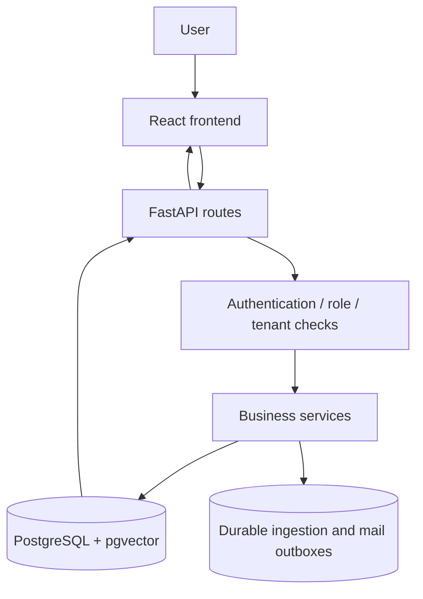
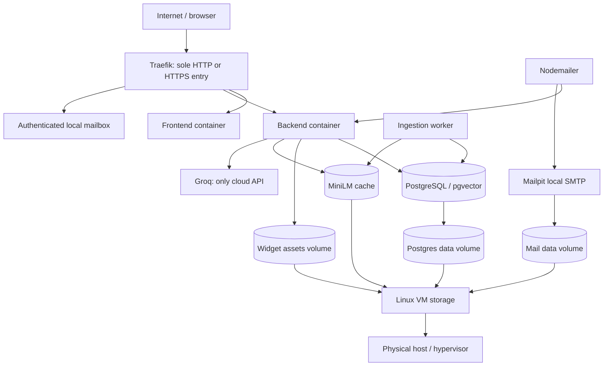
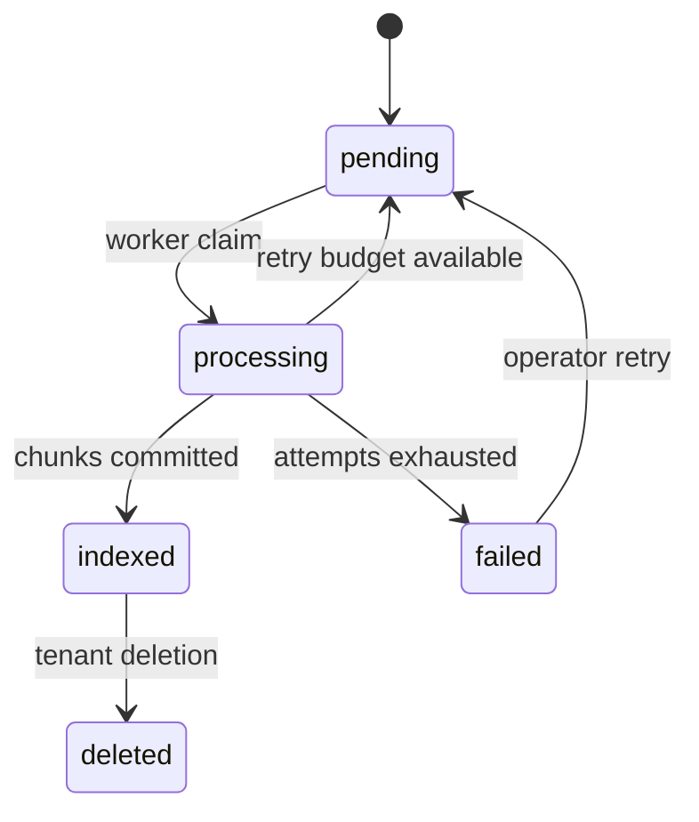
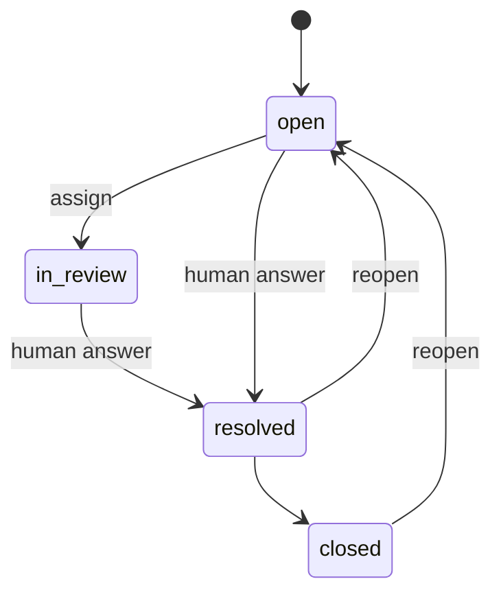
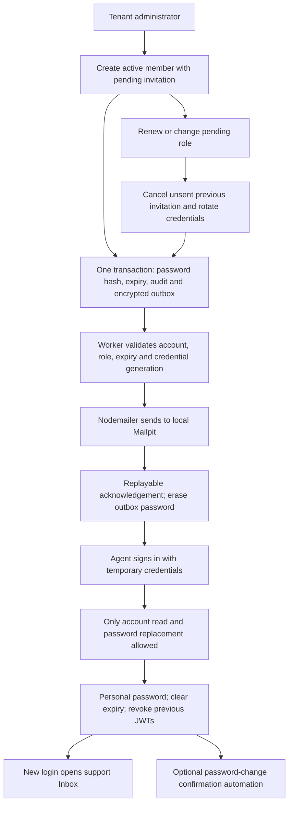

# Architecture and Product Logic

## Product Boundary

Pure greetings/thanks (including "helo") use a restricted Groq conversational prompt without
requiring documents. Exact whole-message matching prevents a greeting prefix from bypassing
grounding for a factual question. These replies have no sources or retrieval-confidence badge
and do not open human-support cases. All messages still count toward the existing usage quota.
The API `reason` distinguishes conversation, insufficient knowledge, retrieval outages and
Groq outages and clarification requests. A sanitized `error_code` diagnoses provider failures
without exposing upstream bodies. A Groq quota outage does not create a fictional business case.

SupportDeflect AI is one self-hosted platform serving multiple organizations. Each organization
owns its knowledge, widget design, team, questions and support cases. Answers are grounded in
retrieved documents; unresolved visitor questions go to human support. Business administration
is separate from tenant operations. The platform is not an autonomous helpdesk capable of
accessing orders or refunding a customer: it has no such external integrations.

## Actors

| Actor | Entry point | Powers | Deliberate restriction |
|---|---|---|---|
| Visitor | Widget on a customer website | Ask questions, read sources, receive a human reply for an escalated case | No tenant session, no document management, no internal notes |
| Tenant Admin | /dashboard | Knowledge import/delete, Playground, analytics, widget design, team invitations, Inbox, subscription usage | Only their organization; cannot change their own commercial plan |
| Support Agent | /dashboard/inbox | Read/assign/review/resolve/close cases and see teammates | No knowledge/configuration/platform administration |
| Super Admin | /platform | Cross-organization BI, create/edit/archive/restore organizations, subscription periods/prices, receipts/refunds, campaigns/automations, audit, failed-job retry, health | Not an implicit tenant member; does not receive tenant document bodies |
| Ingestion worker | Internal process | Claims durable jobs; fetches/parses/chunks/embeds/indexes knowledge | Local database and model; tenant ownership retained |
| Nodemailer worker | Authenticated internal API | Claims encrypted-outbox deliveries, SMTP, acknowledgements and heartbeat | Service token is distinct from user JWTs; no admin session |
| Infrastructure operator | Linux/Compose/CLI | Installation, secrets, bootstrap, backups, restore, manual deployment | Not an application role; requires trusted host access |

Roles come from the current database record, not an unverified browser claim.
JWT token_version invalidates old sessions after password, role or account changes.
New agent invitations expire after seven days and force password replacement.

## Application Flow



The frontend uses one API client and React Query. Authentication changes clear cached tenant data.
Requests also reject successful responses from an obsolete session, including a session change
during JSON or CSV decoding. This prevents pending mutations from repopulating another account's
cache after it was cleared. Widget draft updates merge into the latest state; controls are disabled
while a design save is pending so its response cannot discard newer edits.
FastAPI validates requests with Pydantic, resolves identity and tenant, then invokes services.
SQLAlchemy persists data; Alembic owns schema changes. SQLite uses persisted JSON vectors and
cosine search for native development. PostgreSQL uses vector(384) with an HNSW cosine index.
There is no silent switch to an in-memory store when a database operation fails.

## Code Boundaries

The root layout was already appropriate at the start of the 3-4 October architecture audit.
It is retained: frontend, backend, mailer, widget, infra, scripts and docs have distinct owners.
The refactor targets dependencies inside those modules, not another directory migration.

| Boundary | Responsibility and concrete files |
|---|---|
| HTTP adapters | `backend/app/routers/`: validated input, authorization dependencies, response contracts and small endpoint-specific reads |
| Organization operations | `services/organizations.py`: public IDs, lifecycle, subscription periods, invitations and matching audit/outbox transaction |
| Ledger operations | `services/billing.py`: payment/refund invariants, idempotency and page-scoped refund aggregation |
| Account invitations | `services/invitations.py`: one credential/expiry/revocation workflow shared by tenant and platform administration; caller owns commit |
| Mail delivery state | `services/mailing.py`: encrypted outbox, recipients, scheduling and claims; Nodemailer performs SMTP separately |
| Knowledge processing | `services/ingestion.py`, `ingestion_jobs.py`, `embeddings.py`, `vector_store.py`, `rag.py`: parsing, durable work, retrieval and grounded answers |
| Cross-cutting configuration | `core/config.py`, `core/datetime.py`, `core/logging.py`: validated environment, UTC database normalization and safe local logs |
| Browser transport | `frontend/src/lib/api.ts`: shared authorization/error handling for JSON and CSV; `admin-api.ts` declares administration requests |
| UI state and rendering | `frontend/src/routes/`, `components/`, `hooks/`: file routes, reusable views/primitives, React Query and one SSR hydration hook |

Administrative routes no longer import other route modules. A service operation commits its
business mutation together with audit and mail outbox records; reusable invitation preparation
does not commit on its own. Existing SQLAlchemy sessions and models remain the persistence API.
There is no generic repository, unit-of-work wrapper, controller base class or dependency container.
Small reads stay near their endpoint when a service would only forward the same call.

The ledger list uses three SQL queries for a nonempty page, independent of row count: entries
joined to organization names, grouped refund totals for that page, and the total count. This is
asserted by `tests/test_administration.py`, alongside the existing refund/idempotency API tests.

Known ingestion validation failures remain actionable. Unexpected provider/database exception
values are not stored in public document/job errors. Logs retain error types and call locations
without serializing exception values. A successful retry clears the job's previous error.
SSR error handling is request-local; no global last-error cache associates different requests.

Runtime Python dependencies are in `backend/requirements.txt`; development/test tools are in
`requirements-dev.txt`, which includes the runtime file. Docker installs runtime requirements;
CI and native development install the development file. Frontend runtime/build dependencies are
similarly separated, and unused-variable linting prevents dormant imports from accumulating.

The approved CSS, logos, widget renderer, public routes, API payloads, environment names and
database schema are unchanged by this architecture refactor.

## Widget Flow

```mermaid
sequenceDiagram
  participant Site as Client website
  participant W as Shared Shadow DOM widget
  participant API as FastAPI
  participant DB as Local knowledge / database
  participant LLM as Groq
  participant Agent as Tenant Inbox
  Site->>W: Load script with public company ID
  W->>API: Get saved design (approved Origin)
  API->>DB: Organization + design
  API-->>W: Validated configuration and local logo URL
  W->>API: Question + visitor ID + bounded recent history
  API->>DB: Tenant-scoped hybrid retrieval + header/neighbor context
  alt Indexed context available
    API->>LLM: Question + passages + untrusted history + grounding rules
    LLM-->>API: JSON answer + evidence IDs + optional clarification
    API->>API: Validate schema and source passages; attach citations
  else Insufficient context or retrieval/provider failure
    API->>API: Explicit fallback, never fabricated success
  end
  API->>DB: Conversation and optional support case
  API-->>W: Answer, sources, score, optional case capability
  Agent->>API: Resolve with human answer
  API->>DB: Save resolution and audit event
  W->>API: Poll pending case with scoped capability
  API-->>W: Status and human answer only
```

The local multilingual model is warmed before readiness. Persisted vectors carry model identity;
migration 0006 and reindexing rebuild outdated vectors from saved text. BM25Plus and cosine
rankings are fused without treating cosine as a probability or a factual-answer gate. History
resolves references but never replaces source documents. Ambiguous company/person questions
ask for clarification without a support case. A CV describes a profile, not its uploading
organization. See [AI and local knowledge](AI.md) for the full grounding contract and limits.

The public company ID is not a secret. Approved Origin checks reduce browser abuse; a nonbrowser
caller can forge Origin, so quotas/rate limits still apply. Capability tokens have audience
widget-case, bind organization and case, expire after seven days and cannot authenticate as users.
They travel in a POST body, not access-log query strings. Up to ten pending cases are retained in
the embedding site's localStorage; clearing it loses that browser's follow-up access.
Polling runs every 15 seconds only while the document and panel are visible.
Replies are asynchronous, not an agent-presence or live-chat promise.

Studio uses an iframe loading the **same backend/app/static/widget.js** as the client snippet.
postMessage checks parent source and origin. Preview requests are bridged to protected /chat:
the administrator JWT stays in the parent and preview questions do not create visitor cases.
A single validated design object travels UI -> API -> JSON database field -> renderer.
Shadow DOM isolates descendant CSS; the host wrapper protects fixed positioning.
Logo upload decodes PNG/JPEG/WebP, bounds bytes/pixels, strips metadata, re-encodes PNG, preserves
ratio and verifies tenant ownership before saving. SVG/remote tracking URLs are rejected.

## Infrastructure Flow



| Container | Network | Storage | Public port |
|---|---|---|---|
| traefik | edge_net | Read-only routing files and optional certificates | 80; optional 443 |
| frontend | edge_net | Stateless build | None |
| backend | edge_net, data_net | widget_assets, hf_cache | None |
| worker | data_net | hf_cache | None |
| postgres | data_net | postgres_data | None |
| mailer | data_net | Outbox in PostgreSQL | None |
| mailpit | edge_net, data_net | mail_data | None |
| migrate | data_net | Schema in PostgreSQL | None |

Traefik uses the file provider, not a Docker socket. Only its fixed IP is trusted for proxy headers.
Networks allow outbound retrieval/Groq/model setup; they are not an egress firewall.
All services use bounded local Docker log rotation. Mailpit has no outgoing relay and disables
remote CSS/fonts and update checks. Image/model downloads are installation dependencies.

## Data Model

| Entity | Responsibility / invariant |
|---|---|
| Organization | Public ID, owned configuration, commercial plan/period, billing currency, archive marker |
| User | Unique email, password hash, role, nullable org, active/reset/version/expiry fields |
| Document | Tenant source metadata, indexing state, active marker |
| VectorChunk | Tenant/document/chunk key, text, embedding; only active indexed documents are searchable |
| IngestionJob | Source/text payload, attempts, claim/lease, completion/error |
| ConversationLog | Immutable AI result, question, sources, score, channel, latency |
| QuestionReservation | Expiring in-flight quota slot, consumed with the conversation or released after failure |
| SupportCase | One escalated conversation, assignee, state, private note, human answer |
| BillingEntry | Append-only payment/refund in integer minor units and one currency; capped linked refund |
| MailMessage | Durable delivery state, idempotency key, encrypted invitation secret, claim token |
| MailAutomation / MailWorkerState | Event preferences and observed delivery-worker health |
| AuditEvent | Actor/scope/action/resource and bounded non-secret metadata |
| RateLimitEvent | Shared request accounting |

PostgreSQL enforces the user-role/org invariant. Tenant filtering is application-level, not database RLS.
Archive is reversible logical deletion; financial/audit history is retained. Hard purging organizations
would violate that product decision and is deliberately not offered as an ordinary CRUD action.

## State Machines



Document and queued job are created in one transaction. Worker leases recover abandoned jobs;
PostgreSQL SKIP LOCKED supports concurrent claims. A conditional update selects one winning
claim on both databases. Completion checks the persisted attempt and UTC lease timestamp:
manual retry can reuse an attempt number, but an obsolete lease cannot complete its successor.
Short quota write transactions use PostgreSQL non-key update locks or a SQLite write reservation; embedding
inference and Groq calls run outside those quota locks. SQLite remains a native development
database; its concurrency regressions do not substitute for real PostgreSQL integration.

The non-key update lock serializes organization quota checks while permitting foreign-key
references from document/case/audit writes. A stronger organization update lock could invert
the document-first retry order when an audit insertion validates its organization reference.
The lock mode follows [PostgreSQL's compatibility rules](https://www.postgresql.org/docs/current/explicit-locking.html)
and [SQLAlchemy's locking API](https://docs.sqlalchemy.org/en/20/core/selectable.html#sqlalchemy.sql.expression.Select.with_for_update).
Local tests inspect emitted PostgreSQL SQL; a live PostgreSQL concurrency run remains required.
Deleted/pending/failed documents are excluded from retrieval even if stale vector rows exist.



A human answer is required for resolved. Closing without a reply is allowed and does not fabricate
an answer. Human resolution does not rewrite the original AI result or inflate AI resolution metrics.

Mail: queued -> sending -> sent, or failed/canceled. Secrets are encrypted at rest and scrubbed
after accepted delivery, cancellation or expiry. DNS/TLS/authentication failures have bounded
retries; a closed connection or timeout can occur after DATA acceptance and requires review.
SMTP is not an exactly-once protocol. A matching result acknowledgement is replayable without
another SMTP send or another retry-delay increment. In-flight messages reserve the daily quota;
PostgreSQL serializes claim reservations through the worker state row.

### Team Invitation Lifecycle



Account state, invitation state and mail state are independent. Mailpit capture is not delivery
to Gmail/Forvia; `sent` means acceptance by the configured SMTP service, not reading or inbox
placement. Team shows this distinction and never links tenants to the shared Mailpit mailbox.
The latest invitation is bound to the member's credential version, role and exact expiry.
Legacy queued invitations without version metadata still require matching role/expiry/account.
Expiry is checked both at login and on authenticated first-login requests. Renewals are refused
while a live worker lease holds the invitation. Deactivation blocks access immediately and cancels
unsent invitations. An already-handed-off SMTP message cannot be recalled, but its account access
is revoked. Reactivation rotates a pending invitation, not an accepted member's personal password.
Claims abandoned for five minutes become `delivery_unknown`, even when SMTP is offline; they
are never blindly resent. Renewing an invitation cancels any obsolete failed delivery.

## Business Rules and BI

| Measure / rule | Meaning |
|---|---|
| MRR | Current active, nonexpired contracted monthly fees in selected currency |
| ARR | MRR x 12, an annualized run rate, not booked revenue |
| Collected revenue | Recorded payments minus linked refunds during selected period |
| Currency | Compared separately; no invented exchange rates or mixed-currency sum |
| Trend | Current selected period compared with previous equal-length period |
| AI resolution rate | AI resolved conversations / logged conversations; not proven ticket-cost savings |
| Confidence | Retrieval similarity heuristic; not probability of truth |
| UTC charts | Daily aggregates from all matching rows, not the ten latest conversations |
| Trial | 14 days; 25 documents, 2,000 chunks, 100 questions / rolling 30 days |
| Starter | 25 documents, 2,000 chunks, 2,000 questions / rolling 30 days |
| Pro | 250 documents, 25,000 chunks, 25,000 questions / rolling 30 days |
| Enterprise | 10,000 documents, 1,000,000 chunks, 1,000,000 questions / rolling 30 days |
| Expiry/suspension | Blocks new knowledge/chat operations; preserves data and operator recovery |
| Receipts | Manually recorded external transactions; no automatic bank charge/refund |

Monetary amounts use integer minor units. Refunds reference original payments, cannot exceed
remaining balance and use idempotency keys. Period adjustments require a reason and are audited.
Bulk campaigns preview recipients and require an unchanged audience fingerprint before queueing.

## Architecture Decisions

- Existing FastAPI/React stack retained; no artificial microservice split of business logic.
- Separate workers isolate slow indexing and SMTP from request lifetimes.
- Groq model selection is configuration, not a code dependency on a model name.
- Local embeddings and persisted vectors avoid hosted retrieval/storage.
- No fake production charts, remote fonts, mock AI or external logo storage.
- Manual deployment and explicit phase gates preserve the teacher's operations requirements.
- Residual limits and unexecuted infrastructure proofs are in AUDIT.md, not hidden behind compilation.
