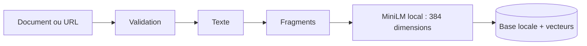
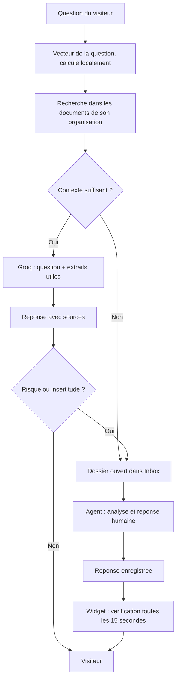
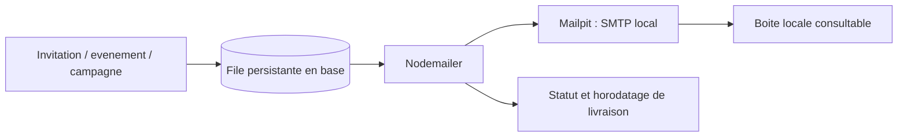
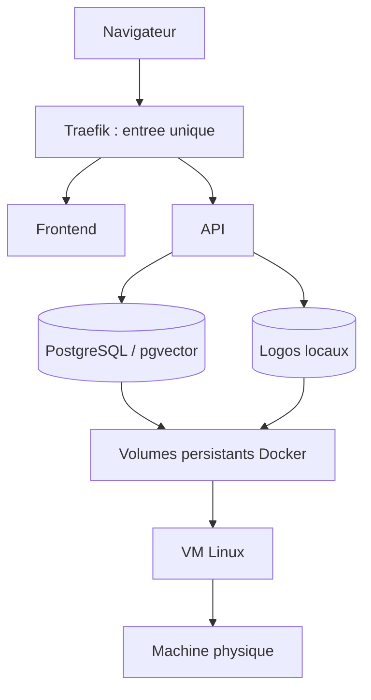

# SupportDeflect AI : guide fonctionnel

## 1. Le produit

Le dossier de présentation détaillé et la matrice de phase 1 sont disponibles dans
[README_SUIVI_PHASE_1.md](../README_SUIVI_PHASE_1.md). Le rôle de chaque fichier et
le vocabulaire technique sont expliqués dans [FILE_GUIDE_FR.md](FILE_GUIDE_FR.md).

SupportDeflect AI est une plateforme de support partagee entre plusieurs organisations.
Chaque organisation dispose de sa propre base documentaire, de son widget, de son equipe
et de sa boite de traitement des demandes. Les donnees ne sont pas partagees entre clients.

Le widget ne connait pas automatiquement les commandes, les paiements ou les comptes du site
client : ces integrations n'existent pas. Il repond a partir des documents effectivement indexes.
Quand les connaissances sont insuffisantes, il transmet la demande a l'equipe humaine.

## 2. Qui fait quoi ?

| Acteur | Son espace | Ses responsabilites | Ce qu'il ne peut pas faire |
|---|---|---|---|
| Visiteur | Site du client, widget | Poser une question, consulter les sources, recevoir une reponse humaine | Administrer une organisation ou lire les notes internes |
| Tenant Admin | /dashboard | Documents, tests de reponses, statistiques, design du widget, equipe, demandes | Administrer les autres organisations ou modifier son contrat commercial |
| Support Agent | /dashboard/inbox | Prendre en charge, annoter, resoudre et fermer les demandes | Modifier les documents, le widget, les abonnements ou la plateforme |
| Super Admin | /platform | Piloter le produit, les organisations, les abonnements, les recettes, les campagnes et la sante technique | Se faire passer automatiquement pour un client ou consulter librement ses documents |
| Operateur technique | VM, Docker, scripts | Installer, configurer, sauvegarder, restaurer, mettre a jour | Ce n'est pas un role disponible dans l'interface client |

Deux processus techniques travaillent sans interface : le worker d'indexation et le worker
Nodemailer. Le premier transforme les documents en connaissances recherchables ; le second
envoie les messages en attente vers le serveur SMTP local.

## 3. Connexion et comptes

```mermaid
flowchart LR
  Inscription --> Organisation[Organisation + Tenant Admin]
  Invitation --> Temp[Mot de passe temporaire]
  Temp --> Changement[Changement obligatoire]
  Connexion --> Role{Role en base}
  Role -->|super_admin| Plateforme[/platform]
  Role -->|tenant_admin| Gestion[/dashboard]
  Role -->|support_agent| Demandes[/dashboard/inbox]
```

Une inscription publique ne cree jamais un Super Admin. Celui-ci est cree par le script de
bootstrap de l'operateur. Son organisation est volontairement absente : il gere la plateforme,
il n'appartient pas implicitement a tous les clients.

Le mot de passe d'une invitation expire apres sept jours. Il est remplace avant tout travail
protege. Les changements de mot de passe, de role ou d'activite invalident les anciens jetons.
La desactivation d'un compte bloque son acces sans effacer l'historique de ses actions.

## 4. Base de connaissances

| Action | Traitement reel | Resultat visible |
|---|---|---|
| Importer PDF/TXT/Markdown | Validation de taille/type, extraction du texte | Document en attente, puis indexe ou en echec |
| Importer une URL | Controle de destination publique, redirections et taille | Contenu extrait, puis indexe |
| Indexer | Decoupage, embeddings MiniLM locaux, stockage des fragments | Nombre de fragments et date d'indexation |
| Supprimer | Desactivation du document et retrait de ses vecteurs | Document exclu des recherches |
| Reessayer un echec | Nouvelle tentative controlee par le worker | Etat et erreur actualises |



Le statut "en attente" signifie que la demande a ete enregistree, pas que le document est
deja exploitable. Seuls les documents actifs et indexes sont recherches.
PostgreSQL/pgvector est la cible Docker. SQLite conserve aussi de vrais vecteurs en developpement.

## 5. Question, IA et intervention humaine



La question, un historique recent borne et les extraits selectionnes peuvent etre envoyes au LLM.
Les documents, les embeddings, les journaux et les dossiers restent locaux.
Un echec du fournisseur est une panne operationnelle explicite : il ne cree pas de fausse
reponse IA ni de dossier metier artificiel. Une ambiguite appelle une clarification ; une
connaissance absente ou un risque metier peut conduire au suivi humain dans le widget.

Le score de confiance mesure la proximite documentaire, pas une probabilite scientifique de verite.
Le Playground utilise la meme logique de reponse, mais ne cree pas de dossier visiteur.
Les reponses humaines ne modifient pas retroactivement les statistiques des reponses IA.

L'agent peut affecter un dossier, ecrire une note interne, le resoudre avec une reponse ou le fermer.
La note reste privee. Le visiteur recoit uniquement le statut et la reponse finale grace a un jeton
limite a ce dossier, valable sept jours. Il ne s'agit pas d'une messagerie instantanee avec presence
des agents. Le suivi reprend apres rechargement tant que le stockage local du navigateur est conserve.

## 6. Widget Design Studio

| Groupe | Personnalisation |
|---|---|
| Geometrie | Largeur/hauteur, taille du launcher, position, marges, arrondi |
| Apparence | Theme clair/sombre/systeme, couleur principale, fond, texte |
| Contenu | Titre, accueil, sous-titre, placeholder, contact support |
| Identite | Logo SupportDeflect, robot ou logo personnalise, taille du logo |
| Ouverture | Ferme, ouvert immediatement ou ouverture retardee |
| Installation | Domaines autorises, snippet copiable, page HTML telechargeable |

La preview charge exactement le meme moteur JavaScript que le widget client, dans une iframe.
Ce n'est pas une maquette React differente. La sauvegarde traverse validation frontend, API,
validation backend et base de donnees. Le snippet recharge ensuite cette configuration.

Les logos sont stockes localement apres decodage et reencodage. Leur ratio est preserve.
Le Shadow DOM protege l'interieur du widget contre les styles ordinaires du site hote.
Le footer contient discretement "Powered by SupportDeflectAI".

Un site HTTPS doit charger un widget HTTPS avec un certificat reconnu. Une liste de domaines
vide refuse l'installation. L'identifiant public de l'organisation n'est pas un mot de passe.

## 7. Administration et indicateurs

| Vue | Decision ou action possible |
|---|---|
| Business overview | Comparer activite et recettes, examiner tendances et alertes |
| Organisations | Creer, rechercher, modifier, archiver et restaurer un client |
| Abonnements | Changer plan/statut/tarif, prolonger ou reduire une periode avec motif |
| Revenue & payments | Enregistrer un encaissement externe, un remboursement lie, exporter le registre |
| Communications | Choisir une organisation ou toutes, previsualiser les destinataires, envoyer et suivre |
| System health | Verifier dependances et echecs d'indexation |
| Audit trail | Retrouver qui a modifie quoi et quand |

MRR = tarifs mensuels actuellement contractes pour les abonnements actifs et non expires.
ARR = MRR multiplie par douze. Ce ne sont pas des sommes encaissees.
Les recettes nettes sont les paiements enregistres moins les remboursements lies.
Les devises sont analysees separement : aucune conversion inventee.

L'archivage est la suppression logique du CRUD : il bloque l'acces tout en conservant les traces
comptables et administratives. La restauration est possible. Un clic sur "Record payment"
n'effectue aucun prelevement bancaire : l'operateur enregistre un paiement deja recu ailleurs.

Les quotas sont reels : documents, fragments, taille des imports et questions sur trente jours
glissants. Un abonnement expire ou suspendu empeche de nouvelles operations concernees,
sans effacer les donnees de l'organisation.

## 8. Emails



Les evenements configurables comprennent bienvenue, modification/echeance d'abonnement,
reception d'un paiement et changement de mot de passe. Les invitations restent obligatoires.
Les campagnes utilisent une confirmation des destinataires et une cle d'idempotence.

La configuration actuelle respecte la contrainte locale : les messages sont captures dans
Mailpit, pas envoyes sur Internet. L'adresse expediteur peut etre celle demandee sans signifier
que Gmail a livre le message. Activer un SMTP externe demanderait de changer explicitement
cette contrainte produit. Les mots de passe initiaux ne sont pas exposes dans les reponses API.

## 9. Infrastructure et presentation



Le frontend affiche et declenche les actions. L'API authentifie, valide et applique les regles.
Les services metier font les calculs et orchestrent les operations. La base persiste l'etat.
Les workers realisent les traitements longs. Le reverse proxy est le seul point d'entree reseau
de la stack Docker. Les fichiers de configuration et les secrets sont separes du code.

Le pipeline build/test n'effectue pas de deploiement automatique. La mise a jour est volontaire
et manuelle, avec sauvegarde avant migration. Les commandes se trouvent dans RUNBOOK.md.

## 10. Ce qui est prouve

Voir [TESTING.md](TESTING.md) pour les resultats executes, [AUDIT.md](AUDIT.md) pour les corrections
et limites, et [PROFESSOR_REQUIREMENTS.md](PROFESSOR_REQUIREMENTS.md) pour chaque exigence du professeur.
Les tests navigateur utilisent des donnees identifiees comme fixtures. Un autre test a reellement
execute MiniLM et Groq. La VM/Docker et le pipeline distant doivent encore etre executes sur
leurs environnements respectifs avant de signer la recette complete du professeur.
